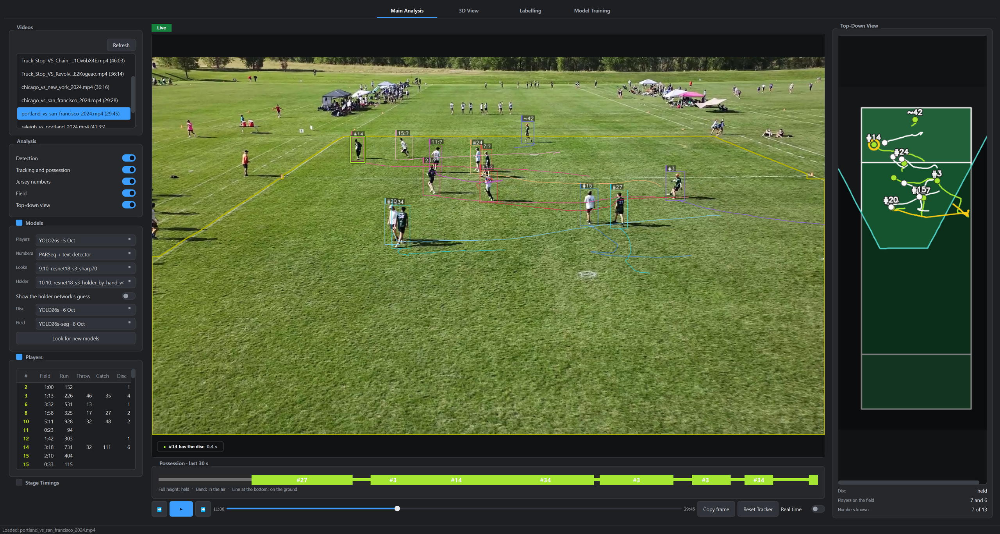
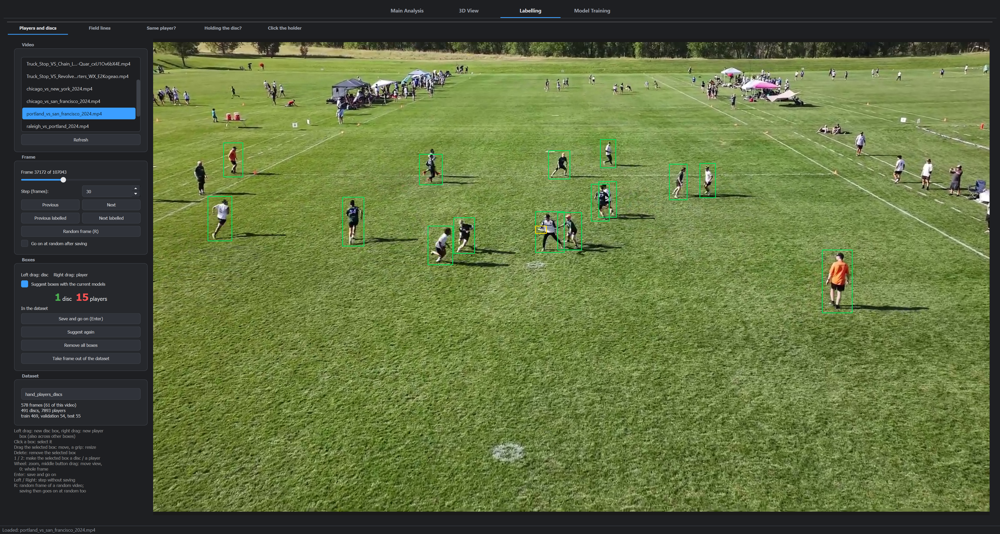
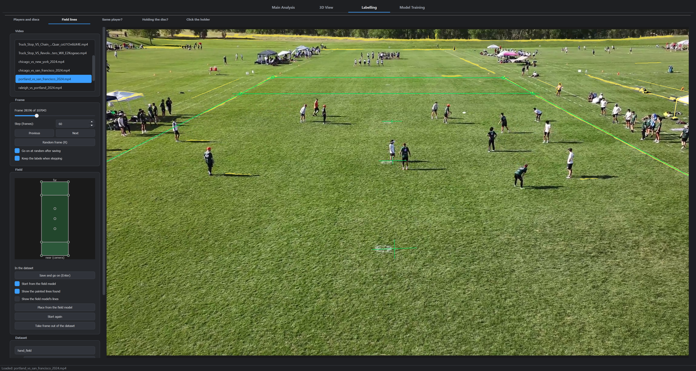
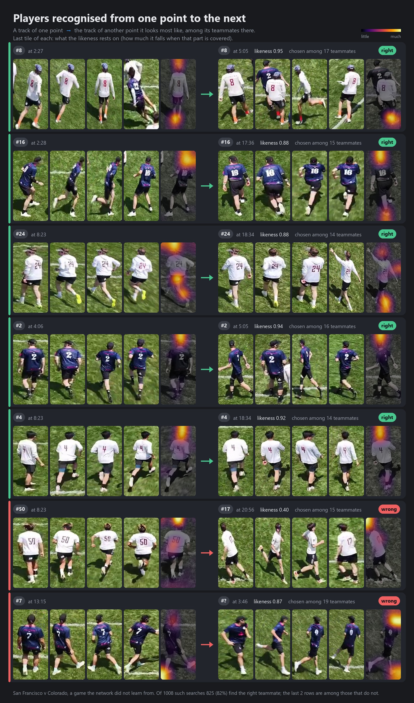

# Ultimate Analysis

A desktop app that analyses Ultimate Frisbee video: it finds the players and the disc,
follows them, reads jersey numbers, tells who has the disc, and shows the play from above.
Built with PyQt5 and YOLO.



## What it does

- **Detection and tracking** of players and the disc.
- **Possession**: who has the disc, and which team had it over the last half minute.
- **The phase of the game**: pull, live play, score, between points.
- **Jersey numbers**, collected per player over time.
- **Top-down view** of the field with the players and the disc.
- **Player statistics**: time on the field, distance run, passes thrown and caught.
- **Export** of what the analysis finds, frame by frame, as tables.
- **Labelling** of players, discs, and the field on frames of your own videos.
- **Training** of detection and segmentation models on those labels from the app.

| Labelling players and discs | Labelling the field |
| --- | --- |
|  |  |

Players are recognised from one point to the next by their looks (a prototype):



## Quick start

Needs Python 3.12 and, in practice, an NVIDIA GPU.

```bash
git clone https://github.com/sylejroy/ultimate-analysis.git
cd ultimate-analysis
python -m venv .venv
.venv\Scripts\activate  # Windows
python -m pip install -r requirements.txt
python main.py
```

1. Put videos in `data/raw/videos` (or fetch some: `python scripts/download_videos.py`).
2. Pick a video in the Main Analysis tab and press play.
3. Switch detection, tracking, jersey numbers, the field, and the top-down view on and
   off as you like.

Models are not part of the repository. Train your own in the Model Training tab, or
place weights under `data/models/`. Labelling is described in
[docs/LABELLING.md](docs/LABELLING.md).

## Development

```bash
python -m pip install -r requirements-dev.txt
python -m ruff check src tests scripts
python -m ruff format --check src tests scripts
python -m unittest discover -s tests
```

The tests use synthetic frames and mocked models, so they need no videos, weights, or GPU.

## License

Copyright (c) 2025-2026 Sylvain Roy.

Ultimate Analysis is licensed under the
[PolyForm Noncommercial License 1.0.0](LICENSE). You may use, change, and share it for
noncommercial purposes: personal use, study, research, and use by clubs, schools, and
other noncommercial organisations.

**Commercial use needs my written permission beforehand.** That includes selling the
software or a service built on it, and using it in the course of paid work. To ask, open
an issue on the [repository](https://github.com/sylejroy/ultimate-analysis).

The licence covers the code of this repository. The libraries it runs on keep their own
licences, which bind whoever installs and uses them: among others Ultralytics (AGPL-3.0,
with a commercial licence sold by Ultralytics) and PyQt5 (GPL v3, with a commercial
licence sold by Riverbank). Versions of this repository published before October 2026
were offered under the GNU General Public License v3.0 and remain so.
